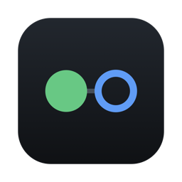
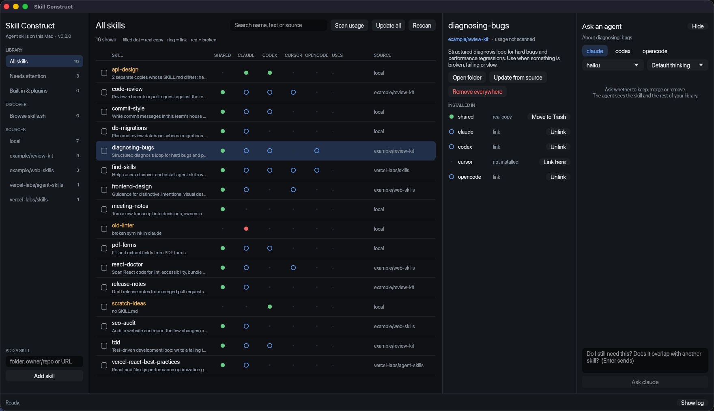

  

<h1 align="center">Skill Construct</h1>

  One window for every agent skill on your machine: 
  what is installed, where, what is broken, and what you never use.

  
  
  
  

> "This is the Construct. It's our loading program. We can load anything, from clothing
> to equipment, weapons, training simulations. Anything we need."
>
> — Morpheus, *The Matrix*

Agent skills are how you give a coding agent kung fu: drop a `SKILL.md` folder in the right
place and it knows something new. After a few months you have dozens of them, spread across
several agents, half of them linked, some of them stale, and no idea which ones ever get used.
Skill Construct is the loading room where you sort that out.

## Features

- **See everything.** One table of every skill in the shared `~/.agents/skills` folder,
  Claude Code, Codex, Cursor and opencode. Skills that something else owns (built into Codex
  or Cursor, or shipped by a Claude Code plugin) are listed read-only so they cannot be removed by accident.
  A dot per harness shows whether it holds a real copy, a link, a broken link or nothing.
- **Spot problems.** Broken links, folders with no `SKILL.md`, missing or mismatched names
  and descriptions, and copies that have drifted apart so two agents run different versions.
- **Find dead weight.** Counts how often each skill was invoked in your Claude Code
  transcripts and lets you sort by least used.
- **Clean up fast.** Remove one skill, a hand-ticked few, or everything from one source, in two clicks.
  Real folders go to the Trash, never straight to deletion.
- **Share across agents.** Link a skill into any harness that lacks it, or unlink it from one.
- **Add and update.** Add from a local folder, `owner/repo` or a URL; update one skill or all of them.
- **Browse skills.sh.** Search the public [skills.sh](https://skills.sh) directory and install
  a result in one click.
- **Reconnect local skills.** Look up an untracked skill by name on skills.sh and switch to
  the published copy so it updates from then on. Your old copy goes to the Trash.
- **Ask an agent.** "Do I still need this? Does it overlap with something else?" goes to
  `claude`, `codex` or `opencode` on the subscriptions you already have, in a chat sidebar.
  Ask about one skill or the whole library, and pick the model and thinking level each agent uses.
- **Updates itself.** The macOS app checks GitHub Releases on launch and installs a new
  version in one click, after checking it is notarized and signed by the same developer.

## Install

**macOS:** download the latest zip from
[Releases](https://github.com/justin-r-wright/skillconstruct/releases/latest), unzip it and drag
`Skill Construct.app` to Applications. It is a universal build (Apple Silicon and Intel),
signed and notarized, for macOS 11 or later.

**From source**, with a recent Rust toolchain:

    git clone https://github.com/justin-r-wright/skillconstruct
    cd skillconstruct
    cargo run --release

Optional extras, used only if present:

| For | You need |
|---|---|
| Adding remote skills and updating | Node.js (`npx`) |
| Asking an agent | The `claude`, `codex` or `opencode` CLI, installed and logged in |

## Where it looks

| Column | Folder |
|---|---|
| shared | `~/.agents/skills` (where `npx skills` installs) |
| claude | `~/.claude/skills` |
| codex | `~/.codex/skills` |
| cursor | `~/.cursor/skills` |
| opencode | `~/.config/opencode/skills` |

New local skills are copied into the shared folder and linked into each harness that exists.

## How it works

- Remote installs and updates shell out to [`npx skills`](https://github.com/vercel-labs/skills).
  Removing a skill also drops it from `~/.agents/.skill-lock.json`, so an update will not bring it back.
- Usage counts come from Claude Code transcripts only (`~/.claude/projects`). "Never used"
  means never used in Claude Code.
- Agents are asked read-only: `claude -p --tools ""`, `codex exec -s read-only`, `opencode run`.
  The model and thinking level you pick from the dropdowns are passed as flags and remembered
  in `~/.config/skillconstruct/models`. Codex and opencode models are listed from their own CLIs.
- Browsing uses the same search endpoint as `npx skills find`. It is not a documented API,
  so it may change.

## Privacy

Skill Construct has no account and no telemetry. It makes two kinds of request itself: on
launch the macOS app asks GitHub for the latest release, and a skills.sh search or lookup
sends the words you typed or the skill names you chose to look up. Everything else that leaves your machine is something you trigger:
`npx skills` fetching a repo, or a question you send to an agent CLI, which includes that
skill's `SKILL.md` and the names and descriptions of your other skills.

## Platform support

| Platform | Status |
|---|---|
| macOS | Supported and tested |
| Linux | Builds from source should work; untested |
| Windows | Not supported |

## Roadmap

- More skill directories besides skills.sh
- Usage counts from Codex and other agents, not only Claude Code
- Support for more harnesses
- Homebrew cask

## Contributing

Issues and pull requests are welcome. The code is two files:

- `src/core.rs` does scanning and file operations with no UI, and is tested against a
  throwaway home directory.
- `src/main.rs` is the [egui](https://github.com/emilk/egui) front end.

Run `cargo test` before opening a pull request. `scripts/release-macos.sh` builds the signed
macOS app into `dist/`; it needs a Developer ID certificate, plus a `notarytool` keychain
profile passed as `NOTARY_PROFILE` to notarize.

## License

[MIT](LICENSE). Not affiliated with Anthropic, OpenAI, Cursor, opencode, Vercel or Warner Bros.
